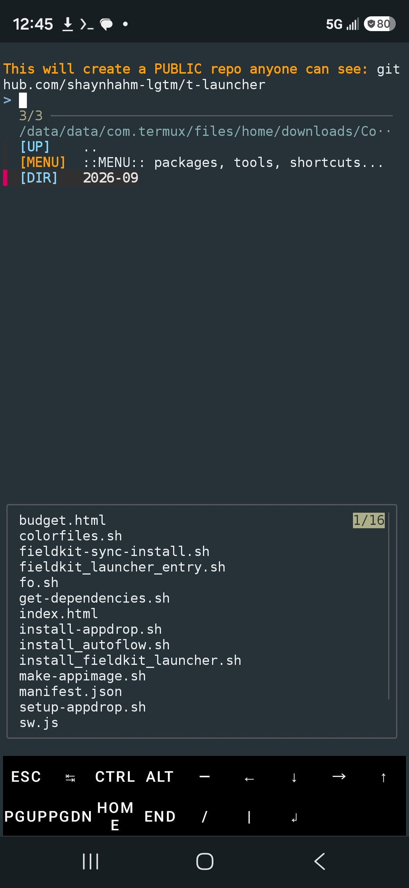
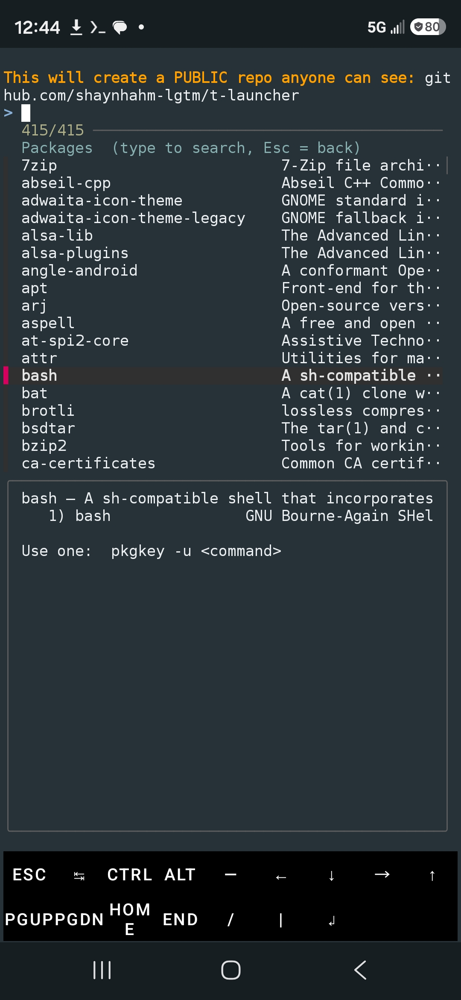
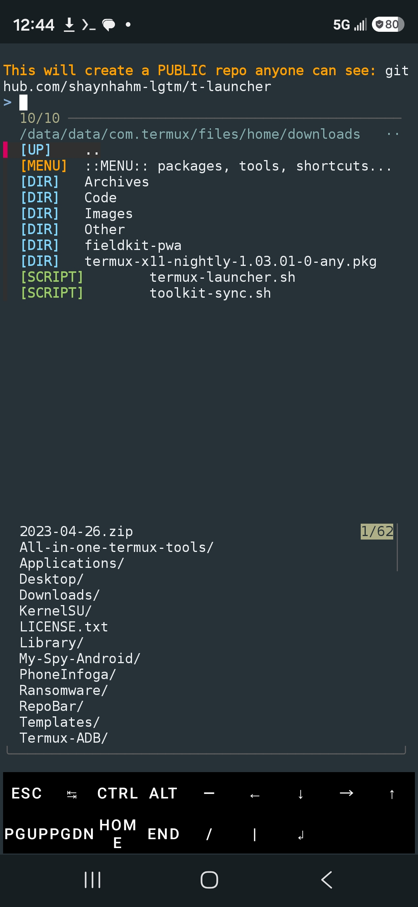
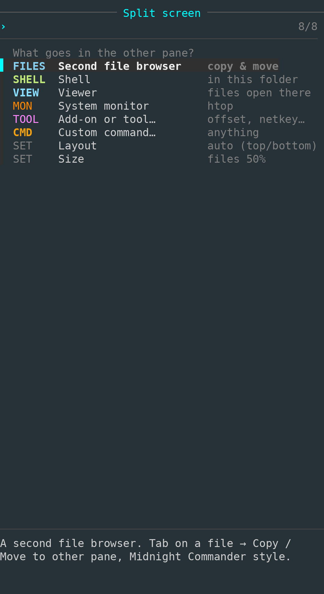
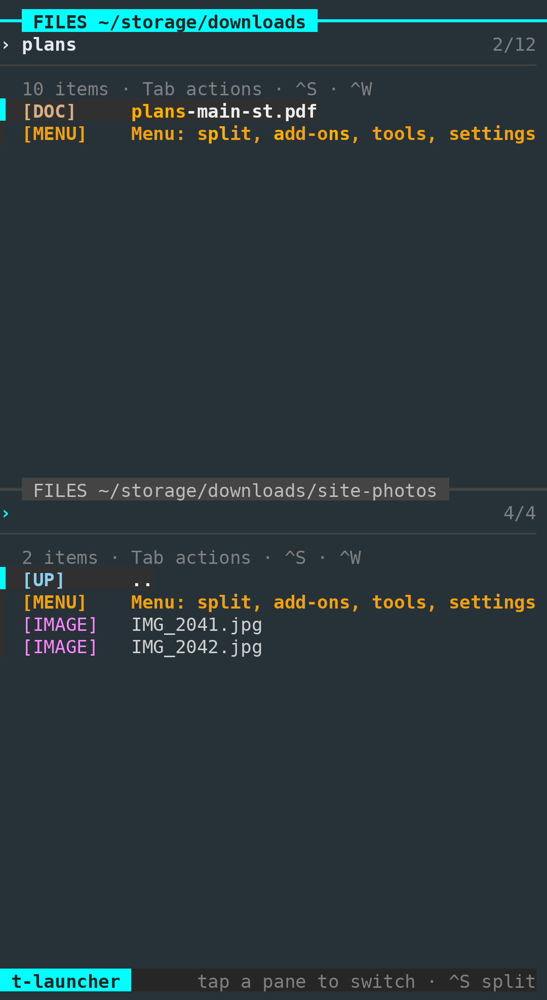
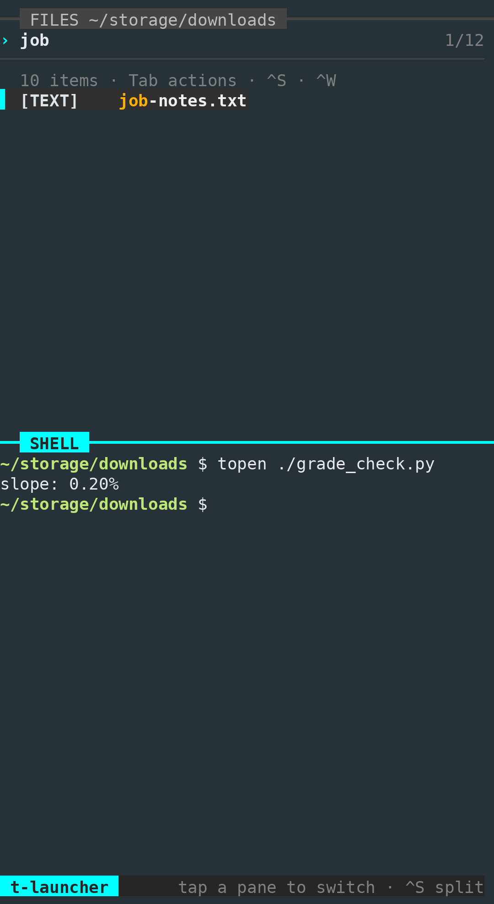
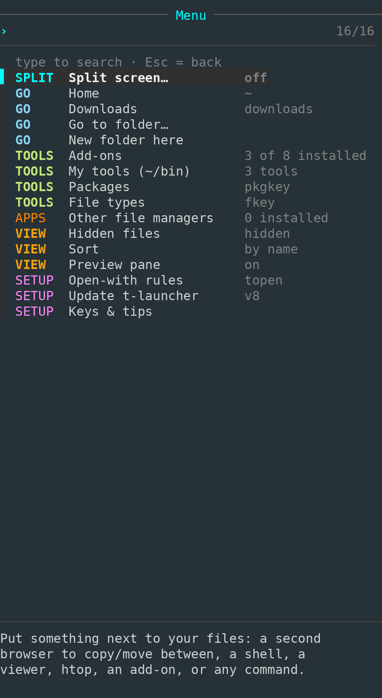

# t-launcher

**A color-coded file browser and command finder for Termux.**
Browse your files, see what anything is, and open it with the right thing, all from one fuzzy-search menu.
Comes with **topen** (open any file with the right tool), **fmget** (install the top 10 Termux file managers), **pkgkey** (what can my installed packages do?) and **fkey** (what is this file and how do I use it?), plus nine optional [add-ons](#add-ons).

**New in v8:** [split screen](#split-screen) (Ctrl+S) and a [regrouped menu](#the-menu).

  

## Install

```
curl -fsSL https://raw.githubusercontent.com/shaynhahm-lgtm/t-launcher/main/install.sh | bash
```

Then type `t-launcher`. Needs only `fzf`, which the installer adds for you.

Want the add-ons too? Add `-s -- --addons` (or name just the ones you want):

```
curl -fsSL https://raw.githubusercontent.com/shaynhahm-lgtm/t-launcher/main/install.sh | bash -s -- --addons
curl -fsSL https://raw.githubusercontent.com/shaynhahm-lgtm/t-launcher/main/install.sh | bash -s -- --addons tdoctor offset
```

Or skip all that: open **MENU → Add-ons** in t-launcher, and anything not installed yet installs itself when you pick it.

## What it does

- **Enter just opens it**: t-launcher figures out what the file really is and opens it with the right thing. Scripts run, archives extract, photos/video/PDFs/APKs open in the right Android app, text opens in a viewer, configs open in nano. **Tab** (or Ctrl+O) brings up the full action menu instead.
- **Color-coded listing**: folders, scripts, executables, archives, packages, web pages, and text files each get their own color. Folders are listed first.
- **Live preview**: see inside a file or folder before opening it (Ctrl+P toggles it).
- **Smart actions**: select a file and the best action is starred at the top: run a `.py`, extract a `.tar.gz`, open an `.html` in your browser. `chmod +x` is handled for you.
- **fkey built in**: "Commands for this file" lists the right commands for that file type with your filename already filled in. Pick one, tweak it, run it.
- **pkgkey built in**: search every installed package, preview the commands it gives you, then run, read help, or open the man page.
- **Install any script as a command**: turn a script into something you can type from anywhere.
- **No dead ends**: Esc goes back one step like a browser, and `..` always goes up.
- **10 file managers, one tap**: open the current folder in yazi, mc, ranger, nnn, lf, vifm, broot, clifm, fff or walk. Not installed yet? Pick it and it installs itself.
- **File basics built in**: copy, move, rename, delete, new folder. **Tab on a folder** gets its own menu too.
- **Hard to lose things**: Delete moves things to a trash you can undo (it uses the cleankey add-on, which installs itself the first time). Replacing a file sets the old one aside and puts it back if anything fails. Moving between Termux and phone storage copies, checks every byte, and only then removes the original. The only permanent delete is outside your home folder and Download, and that one makes you type `delete`.
- **Sort by name, newest or biggest**: newest-first is handy in Downloads. Hidden files, sort and preview settings are remembered.

## Split screen

Press **Ctrl+S** (or **MENU → Split screen**) and pick what goes in the other pane:

| Pick | What you get |
|---|---|
| **Second file browser** | Two folders at once. Tab on a file → **Copy / Move to other pane**, Midnight Commander style. Both panes refresh on their own. |
| **Shell** | A prompt in the folder you're in. Tab on a script → **Run in split pane** types it into that shell. |
| **Viewer** | Files you open (Enter, View, Edit) show up over there, so your file list stays put. |
| **System monitor** | htop: CPU, memory, what's running. Installs itself. |
| **Add-on or tool** | Any add-on or `~/bin` tool next to your files, like `offset` while you look at plans. |
| **Custom command** | Anything you type, aliases included. Remembered for next time. |

Then: **tap a pane** (or **Ctrl+W**) to switch, and the split menu has **swap**, **flip** (top/bottom ↔ side by side), **full screen**, **size** (50/60/70%) and **close**. Layout is automatic: stacked on a phone held upright, side by side on a wide screen. On a small screen, menus go full screen while you pick and the split comes right back.

  

Runs on tmux, installed for you the first time. Already inside tmux? It splits your current window and leaves your tmux settings alone. Leaving t-launcher closes the split; a shell pane stays open.

## The menu

Grouped and searchable (type `sort`, `go`, `split`…), with live status on the right and a one-line explanation of whatever you highlight:



| Group | What's in it |
|---|---|
| **SPLIT** | split screen |
| **GO** | home, Downloads, go to any folder, new folder |
| **TOOLS** | add-ons, your `~/bin` tools, pkgkey, fkey |
| **APPS** | XFCE desktop, Fieldkit, other file managers (each shows only if you have it) |
| **VIEW** | hidden files, sort, preview pane |
| **SETUP** | open-with rules, sync, **update t-launcher**, keys & tips |

## Keys

```
Enter        open it with the right thing      Ctrl+S   split screen
Tab, Ctrl+O  actions for that file / folder    Ctrl+W   jump to the other pane
Esc          back one step                     Ctrl+P   preview on / off
..           up one folder                     Ctrl+R   refresh
type         search (try: script  dir  .apk)
```

## The tools on their own

```
pkgkey               list installed packages
pkgkey <package>     show its commands, then run / help / man them
pkgkey -s <term>     search packages
pkgkey -c <command>  which package a command came from
pkgkey -o            export everything to a Markdown file

fkey <ext|file>      what a file type is and how to work with it
fkey -l              list all known file types

topen <file>         open any file with the right thing
topen -n <file>      dry run: what is it, and what would open it
topen -l             what opens what
topen -e             add your own rules, e.g.  md = glow -p {}

fmget                menu of the top 10 file managers (Tab marks several)
fmget all            install all 10
fmget yazi lf        install just those
fmget --extras       yazi preview helpers (images, video, PDF, fd, ripgrep, zoxide)
fmget -l             what's installed
```

## Add-ons

Nine extra tools, each one a single script in [`addons/`](addons). They install to `~/bin`, run on their own or from **MENU → Add-ons**, and install anything they need (nmap, curl, fzf...) the first time you use them.

| Add-on | What it does |
|---|---|
| **dropwatch** | Watches your Download folder and handles new files by type: scripts become commands in `~/bin` (installed, never run), APKs get scanned, AppImages go to appdrop, `.bin` firmware is filed away. Every change pops a notification with an **Undo** button. |
| **tdoctor** | Checks your Termux setup and fixes what it can: storage access, a dead package mirror, half-installed or outdated packages, scripts that won't run (permissions, Windows line endings, bad `#!` lines), PATH, caches, pip upgraded the wrong way. |
| **netkey** | What's on your Wi-Fi: scan, name devices, flag new ones, figure out what a device is from its open ports, connection info, speed test, and a background watch that notifies you when a new device joins. Uses nmap, no root. |
| **offset** | Pipe offset and grade math in feet and tenths: run and diagonal for 11¼, 22½ and 45 bends, find the bend from rise and run, rolling offsets, cut length after take-offs, sewer fall and end elevation. |
| **cardkey** | Runs an M5Stack Cardputer (with M5Launcher) from Termux over Wi-Fi: browse its SD card, send files, flash firmware, boot installed apps, save Wi-Fi networks, back up its settings. Finds the Cardputer on its own. |
| **clipkey** | Clipboard history. Everything you copy while Termux is open gets saved; search it with fzf and copy any clip back. Starts with your shell. Needs Termux:API. |
| **talk** | Voice commands. Say "launcher", "update" or "network" and it runs the tool. If it doesn't understand, pick the command and it learns that phrase. Needs Termux:API. |
| **sukey** | Near-root without unlocking the bootloader (no Knox trip). Uses [Shizuku](https://github.com/thedjchi/Shizuku) to give Termux ADB-level shell access, then: stop Android killing Termux (phantom process killer), remove or freeze bloat (reversible), grant app permissions, system-wide ad-blocking DNS, hidden settings editor, APK installs with downgrades, full logcat. Setup pulls `rish` out of the Shizuku app for you; you just pair Shizuku once over Wireless debugging. |
| **cleankey** | What's safe to delete, and why. Looks through your home folder, `~/bin` and Download and labels everything **KEEP** (Termux or your tools need it), **CHECK** (something uses it, or it's unknown) or **SAFE** (caches, broken links, unfinished or duplicate downloads), showing what uses each item and what it checked. Anything it can't identify is CHECK, never SAFE, and "used by" follows your shell startup files through every script they load. Keys and passwords (`.ssh`, `.gnupg`, `.git-credentials`, `.netrc`…) are **locked**: cleankey won't move them at all. Deleting moves things to a trash with **undo**; nothing is gone until you empty the trash, and it never touches `~/storage`. In t-launcher, **Delete** uses this trash, and Tab on any file → *Safe to delete?* explains it. |

```
dropwatch                    status · start | stop · undo · history · rules
tdoctor                      check, then offer to fix   (--fix = no questions, --quick = offline)
netkey                       menu · scan [--deep] · what IP · info · speed · watch start
offset 2.4                   every common bend for a 2.4 ft offset · offset help for the rest
cardkey                      menu · ls · get · put · flash · boot · wifi · nvs
clipkey                      pick a clip · clipkey <words> · add · start | stop · clear
talk                         listen once · talk loop · talk <words> · add · list · edit
sukey                        menu · setup · start · sh · debloat · restore · freeze · keepalive · adblock on · history
cleankey                     menu · home | bin | dl · why <file> · trash <file> · undo · list · empty
```

Optional extras dropwatch uses if you have them: `apkscan` for APKs and `appdrop` for AppImages. `termux-api` (plus the Termux:API app) turns on notifications and Wi-Fi details.

### How topen decides

1. Your own rules in `~/.config/topen/rules` win.
2. Then the file extension (`.py`, `.tar.gz`, `.apk`, `.mp4`...).
3. No extension or an unknown one? It looks inside: the `#!` line (and fixes Linux paths like `/bin/bash` that don't exist on Termux), the file's magic bytes (ELF, zip, gzip, PDF, PNG...), then `file`, then text vs binary.

Anything a file needs that isn't installed (python, unzip, 7z, java...) gets installed for you. Programs sitting on shared storage, where Android won't run them, are run from a temp copy.

## Uninstall

```
curl -fsSL https://raw.githubusercontent.com/shaynhahm-lgtm/t-launcher/main/install.sh | bash -s -- --uninstall
```

That removes the add-ons too. (Anything sukey changed on the phone stays; undo it first with `sukey restore`, `sukey unfreeze`, `sukey adblock off`.)

## License

MIT
